# ScanGo Backend Architecture

Maintained in this independent Git repository at **docs/architecture.md**. Updated **2026-11-09**. The guide covers the implemented stack, interfaces, data model, operational limits, and release requirements.

## Contents

1. [Scope, users, and repository boundary](#1-scope-users-and-repository-boundary)
2. [Context, containers, and trust boundaries](#2-context-containers-and-trust-boundaries)
3. [Source ownership and module map](#3-source-ownership-and-module-map)
4. [Screens, navigation, and lifecycle](#4-screens-navigation-and-lifecycle)
5. [Primary workflows and recovery](#5-primary-workflows-and-recovery)
6. [Domain, persistence, and data ownership](#6-domain-persistence-and-data-ownership)
7. [API and internal contracts](#7-api-and-internal-contracts)
8. [Security, privacy, and egress](#8-security-privacy-and-egress)
9. [Design, accessibility, and platform adapters](#9-design-accessibility-and-platform-adapters)
10. [Build, checks, and deployment](#10-build-checks-and-deployment)
11. [Architecture decisions and tradeoffs](#11-architecture-decisions-and-tradeoffs)
12. [Requirements traceability](#12-requirements-traceability)
13. [Dated verification and limitations](#13-dated-verification-and-limitations)
14. [Extension rules and companion repository](#14-extension-rules-and-companion-repository)

## 1. Scope, users, and repository boundary

A self-checkout kiosk simulator for the fictional QuickStop Market.

Barcode/search entry, basket changes, coupons, simulated scale/tender checks, API-issued receipts, print, and reset.

This repository owns the Node.js ESM API and SQLite state. UI rendering belongs to the separate frontend. The service validates and executes the domain operations described below.

There are two independent Git roots for this application, each with its own README and architecture guide. A parent app/workspace folder is a checkout convenience. Use synthetic records; current local services remain on loopback.

The current implementation boundary is defined by the source map and contracts in this guide.

## 2. Context, containers, and trust boundaries

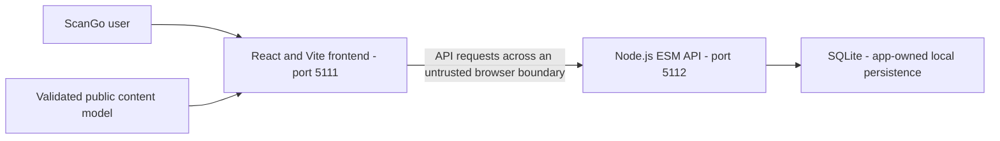

The API is the data authority, but only the identity/ownership controls actually implemented below can be relied on. CORS is not authentication.

### C4 system context

The shopper is an unauthenticated local user. Attendant actions are simulated controls, not staff identity.

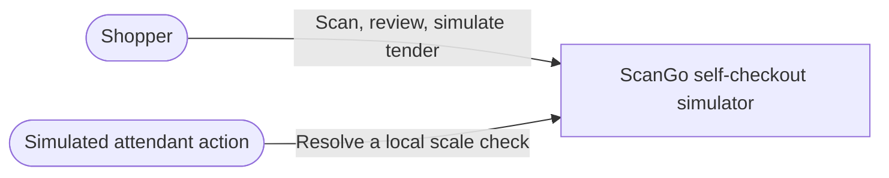

ScanGo has no bank, payment processor, identity provider, inventory service, or external retail integration. It never accepts PAN, CVV, bank credentials, or real payment tokens.

### C4 container view

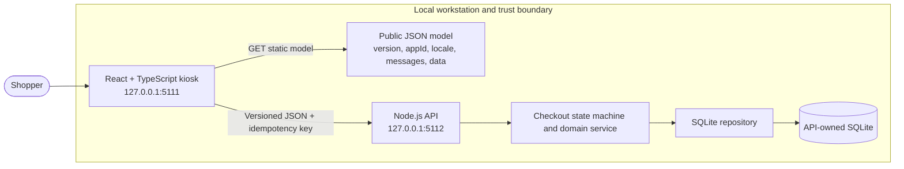

The frontend fetches `public/scango-model.json` with `cache: "no-store"`. Both runtimes validate the supported version-1 `version/appId/locale/messages/data` contract. The model contains user-facing copy, synthetic product/coupon fixtures, presentation settings, and bounded domain limits. API origins and CORS policy are deliberately excluded: Vite build-time variables select an API, and the server owns its `SCANGO_ALLOWED_ORIGINS` allowlist. The API seeds SQLite from the model once; after seeding, its SQLite catalog is authoritative. The frontend sends identifiers, quantity deltas, bounded scale readings, coupon codes, and simulator choices; it never submits a price or total.

## 3. Source ownership and module map

| Owner/path                                                                                                                             | Responsibility                                         |
| -------------------------------------------------------------------------------------------------------------------------------------- | ------------------------------------------------------ |
| [src/server.mjs](../src/server.mjs)                                                                                                    | Process bootstrap, HTTP composition, and configuration |
| [src/routes.mjs](../src/routes.mjs)                                                                                                    | HTTP route and request-adapter owners                  |
| [src/checkout.machine.mjs](../src/checkout.machine.mjs) [src/checkout.service.mjs](../src/checkout.service.mjs)                     | Application workflow/state-machine owners              |
| [src/checkout.repository.mjs](../src/checkout.repository.mjs)                                                                          | Storage/transaction owners; memory where implemented   |
| [src/checkout.schema.mjs](../src/checkout.schema.mjs) [src/content-model.schema.mjs](../src/content-model.schema.mjs)               | Validation/schema and migration authority              |
| [openapi.yaml](../openapi.yaml)                                                                                                        | Published request/response contract source             |
| [src/checkout.machine.test.mjs](../src/checkout.machine.test.mjs) [src/checkout.service.test.mjs](../src/checkout.service.test.mjs) | Examples of existing colocated tests                   |

The source map follows the existing framework directories and test placement.

## 4. Screens, navigation, and lifecycle

This repository has no rendered screens. It supports the frontend through the HTTP/domain contracts in sections 5–7. Its lifecycle entry, response/error mapping, session behavior where present, and storage ownership are listed in section 3. Startup health is http://127.0.0.1:5112/api/v1/health; that configured address is not evidence of a running service. Persistent state is owned by this backend; preserve existing database files during changes.

## 5. Primary workflows and recovery

### Narrated user flows

The scenarios below use a local shopper persona. The attendant is a simulated action with no identity check. Preconditions, outcomes, recovery, authorization boundary, and safe telemetry are explicit.

#### 1. Start a shopper session

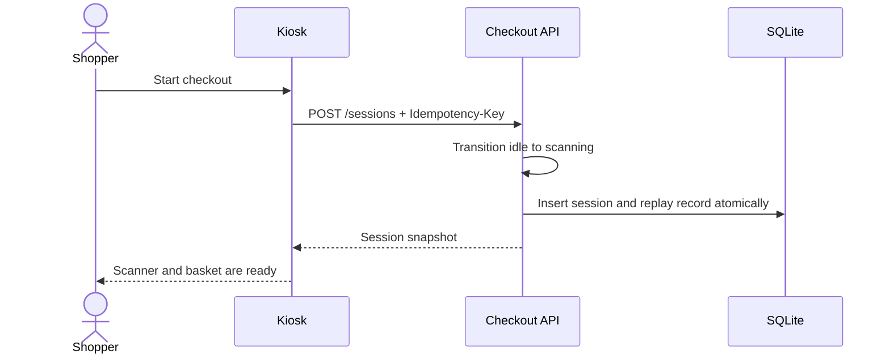

**Precondition:** UI and API are available. **Success:** a persisted scanning session appears. **Failure/recovery:** a safe alert offers retry; the key prevents duplicate session creation on replay. **Authorization/logs:** no authenticated shopper exists; route, request ID, status, and duration are logged without session contents.

#### 2. Search or scan a product

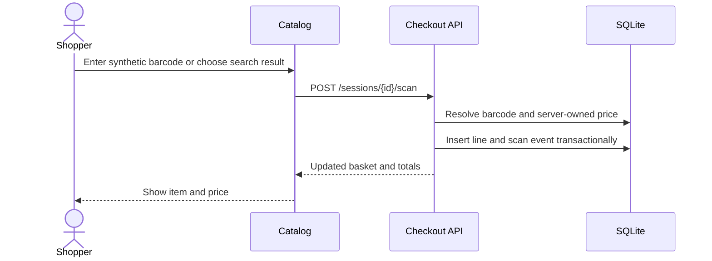

**Precondition:** session is in `scanning`. **Success:** API resolves a known product and adds one unit. **Failure/recovery:** unknown code returns a safe 404; correct the code or use catalog search. **Authorization/logs:** no caller role is trusted; only route/error metadata is logged.

#### 3. Edit basket quantity

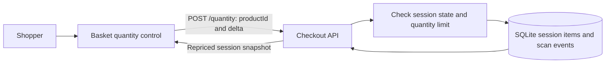

**Precondition:** active scanning session with an item. **Success:** the API applies a bounded delta, removes zero-quantity lines, and returns server totals. **Failure/recovery:** invalid state or quantity returns an error; review the basket and retry. Weighted items require another scale check after quantity changes.

#### 4. Apply or remove a coupon

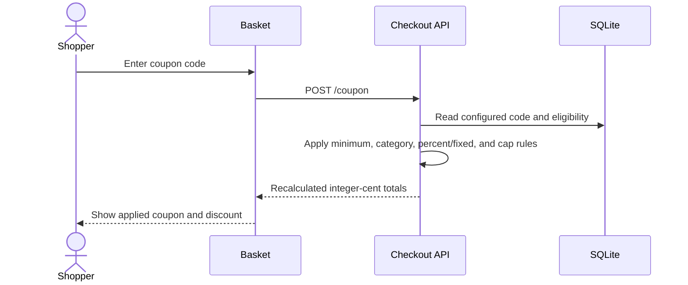

**Precondition:** session is scanning. **Success:** an eligible coupon is recorded and recalculated. **Failure/recovery:** invalid/ineligible codes do not change totals; edit or clear the code. **Authorization/logs:** all rules are server-side; code text is excluded from logs.

#### 5. Check a simulated scale reading

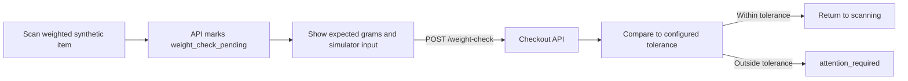

**Precondition:** scan of a weighted item. **Success:** an in-range simulated reading returns to scanning. **Failure/recovery:** mismatch blocks checkout and displays a team-member check. Only bounded integer grams are accepted; logs omit the reading.

#### 6. Resolve an attendant intervention

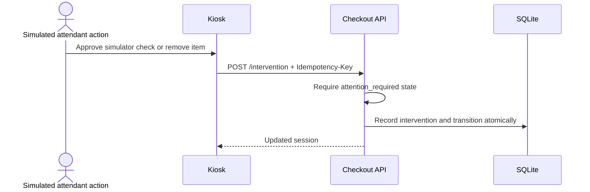

**Precondition:** a scale mismatch is in `attention_required`. **Success:** approval marks the simulated check resolved, or removal deletes the blocked line. **Failure/recovery:** invalid state leaves the basket unchanged. **Authorization:** this endpoint has no staff identity or role gate; that is an explicit deployment blocker.

#### 7. Review checkout totals

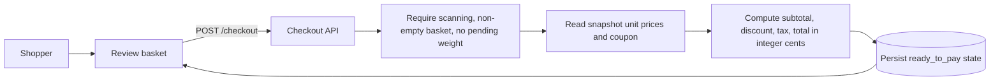

**Precondition:** non-empty basket and all scale checks resolved. **Success:** server returns `ready_to_pay` with exact integer-cent totals. **Failure/recovery:** pending check or empty basket is rejected without advancing state. The browser never supplies price or total values.

#### 8. Simulate tender and retry

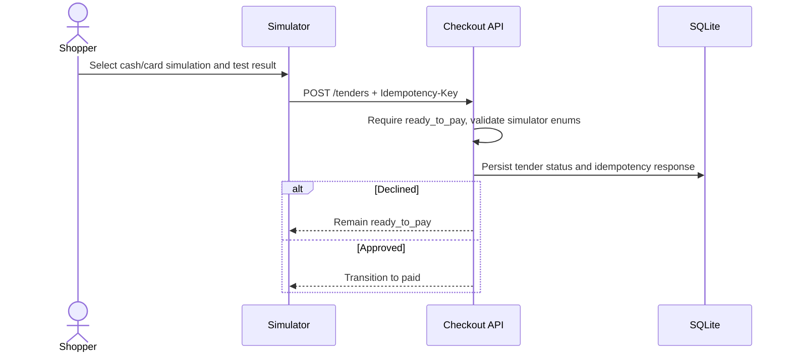

**Precondition:** checkout is ready. **Success:** an approved test outcome enters `paid`; declined remains payable for retry. **Failure/recovery:** repeat with a new key to make another simulated attempt; replaying the old key does not repeat it. No external processor is called and no payment instrument is collected.

#### 9. Issue a receipt

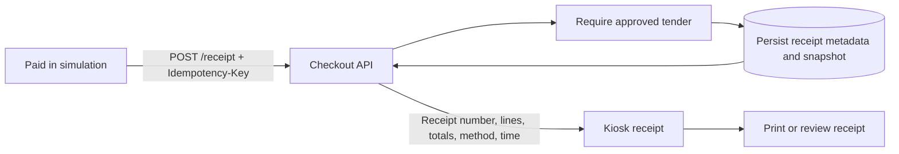

**Precondition:** approved simulated tender. **Success:** one receipt snapshot is stored per session and the session becomes `receipt_issued`. **Failure/recovery:** a missing/declined tender cannot create a receipt; retry after a valid approval. Receipt replay returns the same metadata.

#### 10. Reset the kiosk

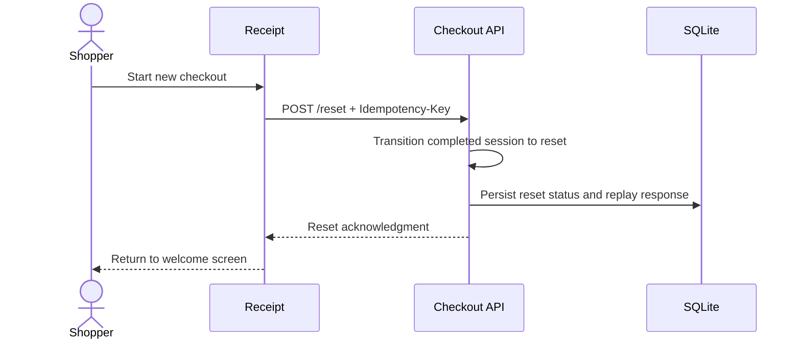

**Precondition:** a persisted session exists. **Success:** the prior session, scans, tender, intervention, and receipt remain recorded while the UI returns to idle. **Failure/recovery:** retrying the same key is safe; a new session receives a new ID. Logs remain metadata-only.

## 6. Domain, persistence, and data ownership

The API owns the current persistence boundary. Keep database engines, schema/migration order, exact-money rules where applicable, and transaction invariants consistent with executable source.

### Data ownership

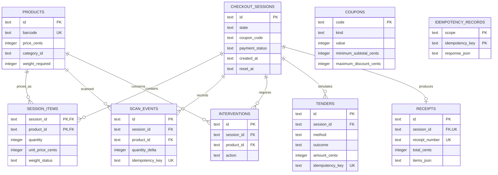

The repository owns schema creation, parameterized statements, seed insertion, explicit transactions, and idempotency replay. Session items snapshot server-owned unit prices. The API stores only synthetic product/checkout data and receipt metadata. SQLite lives at `scango-backend/data/scango.sqlite` by default; `SCANGO_DB_PATH=:memory:` is used in tests.

## 7. API and internal contracts

The repository contract is [openapi.yaml](../openapi.yaml). Keep public paths, status/error envelopes, headers, payload validation, and compatibility tied to that source.

### State machine and API contract

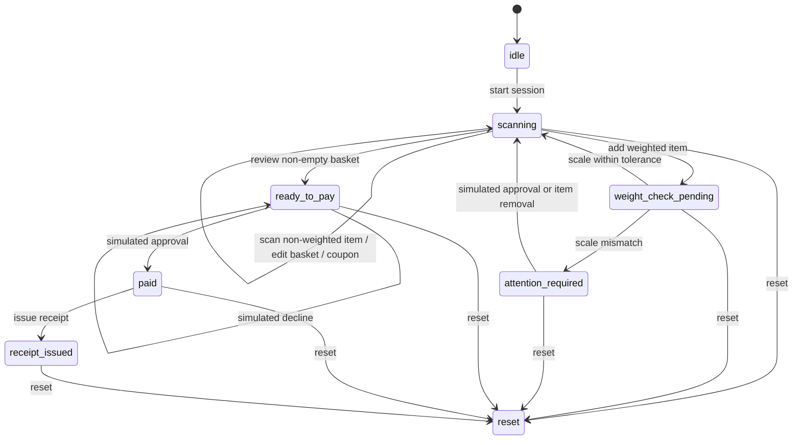

The [OpenAPI document](../openapi.yaml) specifies version `v1`. It exposes health/version/catalog reads, session reads, and idempotent state-changing session actions. Success uses `{ "data": ... }`; errors use `{ "error": { "code", "message", "requestId" } }`. Request size, barcode length, scan-batch count, quantity, scale range, coupon code, and tender enum are server-validated. Coupons, subtotal, discount, tax, and total use integer cents and the API's model/database values.

### API and authorization matrix

| Route group                                                                          | Current caller                | Authentication | Ownership / role check                                               |
| ------------------------------------------------------------------------------------ | ----------------------------- | -------------- | -------------------------------------------------------------------- |
| `GET /health`, `/version`, `/catalog`                                                | Any local caller              | None           | Not applicable; catalog is synthetic                                 |
| `POST /sessions`                                                                     | Any local caller              | None           | Creates an unowned synthetic session; idempotency key required       |
| `GET /sessions/{sessionId}` and `GET /receipt`                                       | Any caller who knows the UUID | None           | No session owner check                                               |
| Session scan, quantity, coupon, weight, checkout, tender, receipt, and reset actions | Any caller who knows the UUID | None           | No shopper ownership check; all mutations require an idempotency key |
| `POST /intervention`                                                                 | Any caller who knows the UUID | None           | Attendant role is not authenticated or authorized                    |

The API binds to loopback by default. UUIDs and CORS are not authorization. A
local caller can read or mutate any synthetic session; there is no idle timeout.
These are deployment blockers, not implied protections.

The tender outcome is deliberately a local user-selectable simulator result. It cannot authorize or move money. A declined attempt is recorded and leaves the session payable; the same idempotency key replays the original response. Receipt issuance requires an approved simulated tender.

## 8. Security, privacy, and egress

Current release limitation: **Shopper session ownership and staff authorization are absent. Two Windows backend tests and critical server coverage fail in the baseline; receipt-only print CSS is absent. Separate IT fixes do not change this baseline.**

Only the local simulator controls in the current source are implemented. CORS, a role label, and mode selection do not provide a new production identity boundary.

Keep private credentials out of public models, browser bundles, logs, URLs, and source archives. No additional runtime network destination or external service is configured. Keep logs limited to the source-defined request/trace and safe aggregate fields. Backups, retention, deletion, and real-user ownership need explicit product/operations decisions before external exposure.

## 9. Design, accessibility, and platform adapters

There is no visual rendering or native package in this API repository. Preserve safe errors and stable contracts so the frontend can present accessible recovery states. Hardware scanning, banking/payment rails, shipping providers, and native integrations remain limited to what the current source actually implements; simulator behavior is not device/provider integration.

## 10. Build, checks, and deployment

Configured npm scripts, from this repository with Node **24.15.0**; use `npm.cmd` in PowerShell:

| Command                     | Actual manifest definition                                                                                                                                                                                                                                                                                                          |
| --------------------------- | ----------------------------------------------------------------------------------------------------------------------------------------------------------------------------------------------------------------------------------------------------------------------------------------------------------------------------------- |
| `npm.cmd run dev`           | `node --watch src/server.mjs`                                                                                                                                                                                                                                                                                                       |
| `npm.cmd run start`         | `node src/server.mjs`                                                                                                                                                                                                                                                                                                               |
| `npm.cmd run test`          | `node --test`                                                                                                                                                                                                                                                                                                                       |
| `npm.cmd run test:coverage` | `c8 --all --include='src/**/*.mjs' --exclude='src/**/*.test.mjs' --check-coverage --lines 90 --statements 90 --functions 90 --branches 90 --reporter=text --reporter=lcov --reporter=json-summary --report-dir=coverage node --test && node scripts/check-critical-coverage.mjs`                                                    |
| `npm.cmd run check`         | `node --check src/server.mjs && node --check src/routes.mjs && node --check src/content-model.schema.mjs && node --check src/checkout.machine.mjs && node --check src/checkout.schema.mjs && node --check src/checkout.repository.mjs && node --check src/checkout.service.mjs && node --check scripts/check-critical-coverage.mjs` |
| `npm.cmd run lint`          | `eslint . --max-warnings=0`                                                                                                                                                                                                                                                                                                         |
| `npm.cmd run format:check`  | `prettier --check "src/**/*.mjs" "scripts/**/*.mjs" "*.mjs" "*.yaml"`                                                                                                                                                                                                                                                               |

Install with `npm.cmd ci` and retain [package-lock.json](../package-lock.json). Registry access is required for a clean dependency installation. These commands describe the configured checks; execution results are listed in section 13.

The API remains loopback-only. Direct-start storage is `data/scango.sqlite` relative to this repository. The adjacent `../scango-frontend/public/scango-model.json` file is a required seed/content input; process environment variables are read, and a .env file is not loaded automatically.

CI configuration is listed in section 3. Run the configured checks before merging or releasing. Deployment requires separate verification of the selected hosting environment.

## 11. Architecture decisions and tradeoffs

Preserve the existing Node.js ESM design and SQLite backend boundary. The local implementation minimizes setup; it does not demonstrate hosted persistence or production identity. Do not introduce shared databases, runtime services, framework migrations, or roadmap integrations as incidental documentation work.

The two Git repositories remain separate. Each owns one maintained README and this repository-local architecture guide. Shared application behavior may be described here for contract context, but implementation changes belong to the owning source module.

## 12. Requirements traceability

| Capability                       | Acceptance                                                        | Owner/path                         | Current status                                                | Evidence                               | Risk                                                                                                                                                                                                                        |
| -------------------------------- | ----------------------------------------------------------------- | ---------------------------------- | ------------------------------------------------------------- | -------------------------------------- | --------------------------------------------------------------------------------------------------------------------------------------------------------------------------------------------------------------------------- |
| Repository-local architecture    | Guide available in this checkout and linked from README           | docs/architecture.md; README.md    | Documented and validated                                      | File, link, and diagram checks         | Keep documentation consistent with source changes                                                                                                                                                                           |
| API composition and domain state | Preserve existing workflows and failure states                    | src/server.mjs and source map      | Implemented; application verification limits are listed below | Current source and existing app design | Shopper session ownership and staff authorization are absent. Two Windows backend tests and critical server coverage fail in the baseline; receipt-only print CSS is absent. Separate IT fixes do not change this baseline. |
| Public deployment                | Verified identity, data durability, recovery, and hosted behavior | Existing deployment/API boundaries | Needs separate hardening/verification                         | No new hosted evidence                 | Local checks do not establish production readiness                                                                                                                                                                          |

## 13. Dated verification and limitations

Last documentation review: **2026-11-09**. The checks below distinguish documentation validation from application and deployment testing.

- Repository-local guide, README link, source-path references, section/contents anchors, and Mermaid syntax: passed documentation validation.
- New application tests/builds, coverage, dependency audits, browser/device accessibility/performance, hosted CI, and Vercel deployment: **not rerun for the documentation updates**.
- Frontend production builds passed on 2026-11-09 with Node 24.15.0. Build success does not establish that all application quality gates pass.
- Outstanding baseline limit: Shopper session ownership and staff authorization are absent. Two Windows backend tests and critical server coverage fail in the baseline; receipt-only print CSS is absent. Separate IT fixes do not change this baseline.

The baseline results below record earlier validation. Re-run the listed commands against the current revision before release.

Previously recorded application verification:

### Verification and migration boundary

The repository is the intended adapter boundary for a future PostgreSQL deployment. Automated API tests use in-memory SQLite and ephemeral ports; Playwright builds into an isolated directory and starts an in-memory API. Exact commands and current coverage live in [the validation status](#13-dated-verification-and-limitations). A hosted design must add identity, per-session ownership, attendant/admin authorization, an idle timeout, TLS, managed migrations/backups, kiosk-device controls, retention policy, and independent security review before real data or payment integrations are considered.

## 14. Extension rules and companion repository

Start with [README.md](../README.md) and this guide. The companion repository is [scango-frontend](https://github.com/gopichand-retail-apps/scango-frontend); clone the pair as siblings when using the existing local integration/model contract. This guide is inside the current repository and does not depend on a parent-folder architecture file to exist.

Update this guide when owned source, routes, persistence, identity, UI states, egress, or deployment behavior changes. Coordinate public contract changes with the companion repository and tests. Preserve existing data, run isolated checks with synthetic records, record failures, and review release and infrastructure changes before publication.
